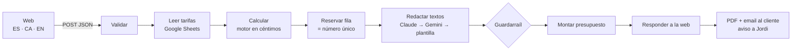

# Presupuestos con IA · Reformas Barcelona

Caso práctico para **NU Automatiza**: un cliente rellena un formulario web y recibe al momento un presupuesto
de reforma con el formato de la empresa, por pantalla, por email y en PDF. Jordi, el gerente, recibe un aviso y
la solicitud queda registrada en su hoja de cálculo.

**Demo:** https://reformas-barcelona-presupuesto.vercel.app

> Todos los datos (empresa, tarifas, clientes) son ficticios, tal y como indica el enunciado del caso.

## Cómo funciona



**Los números los pone el código; la IA solo escribe.** El motor calcula con las tarifas de la hoja de Jordi
(en céntimos, con el mismo redondeo que Excel) y la IA redacta el saludo, el resumen y la lista de trabajos sin
recibir ningún importe. Un guardarraíl rechaza cualquier texto que contenga precios, enlaces, teléfonos o promesas
("gratis", "descuento"…); si Claude falla, redacta Gemini, y si también falla, una plantilla. El cliente siempre
recibe su presupuesto.

**Caso de oro** (el presupuesto de ejemplo de la empresa): baño de 6 m², calidad media, demolición y fontanería
→ subtotal 6.690 €, IVA 1.404,90 €, **total 8.094,90 €**.

## Qué incluye

- Formulario accesible y *mobile-first*, en español, catalán e inglés, con varias estancias por solicitud.
- Validación con el mismo motor en el navegador y en n8n (errores claros, campo a campo).
- Tarifas editables por Jordi en Google Sheets, con tarifas de respaldo si la hoja falla o tiene un precio absurdo.
- Numeración P-AAAA-NNNN sin duplicados aunque lleguen dos solicitudes a la vez (reserva atómica de fila).
- Email HTML al cliente con el PDF adjunto, PDF descargable desde la web y aviso a Jordi con lo importante.
- Defensa contra inyección de prompt, trampa anti-bots invisible y avisos por email si algo falla.
- Módulo de visión: el cliente sube una foto y Gemini sugiere extras (el precio lo sigue calculando el motor).

## Estructura

| Carpeta | Qué hay |
|---|---|
| `engine/` | Motor puro (sin dependencias): validación, cálculo, tarifas, numeración, guardarraíl, prompts y HTML del presupuesto. Lo usan los tests, la web y n8n. |
| `n8n/` | Código de los nodos y `build.mjs`, que empaqueta el motor dentro de cada nodo Code. |
| `web/` | La web (HTML, CSS y JavaScript sin frameworks). |
| `tests/` | Tests unitarios (`node:test`) y `tests/eval/`, la evaluación contra el flujo real. |
| `docs/` | Diseño, plan de implementación y puntos clave de la presentación. |

## Probarlo en local

Requiere Node 22 o superior; no hay dependencias que instalar.

```bash
npm test          # tests del motor y de los nodos de n8n
npm run build     # web en dist/ y nodos de n8n en n8n/generated/
npm run serve     # http://localhost:5173
node tests/eval/run-eval.mjs   # evaluación contra el webhook de producción
```
