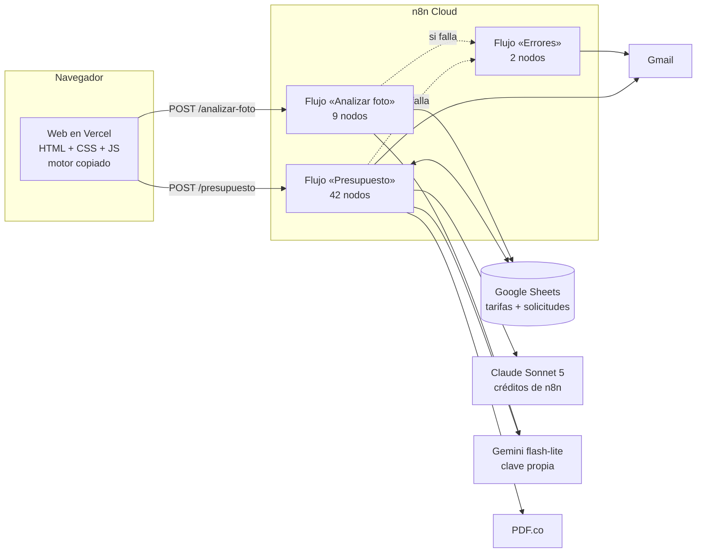

# Informe de aprendizaje · Presupuestos con IA para Reformas Barcelona

> Para Iker. Objetivo: que entiendas cada pieza lo bastante bien como para explicarla, defenderla y cambiarla tú mismo.
> Léelo en orden la primera vez; después úsalo como chuleta (las secciones 5 y 15 son las más útiles para la entrevista).

**Enlaces:** web https://reformas-barcelona-presupuesto.vercel.app · código https://github.com/ikerreki/reformas-barcelona-presupuesto
· n8n `https://ikerrodriguez.app.n8n.cloud` (flujos «Presupuesto», «Analizar foto» y «Errores») · hoja de Google «Reformas Barcelona · Tarifas y solicitudes».

---

## 1. El problema y la solución en un minuto

**Problema.** Jordi (gerente) prepara cada presupuesto a mano con un Excel de tarifas: tarda, se equivoca a veces y el
cliente espera días. El caso pide automatizarlo: formulario web → n8n → cálculo con las tarifas → la IA redacta → el
presupuesto aparece en la web. Extras: email, PDF, registro en Google Sheets, varias estancias, errores claros e ideas propias.

**Solución (frase para la entrevista).** *«Los números los pone el código; la IA solo escribe.»*
- Un **motor de cálculo** propio (JavaScript puro, en céntimos) calcula con las tarifas que Jordi edita en **Google Sheets**.
- **Claude** redacta el texto personalizado **sin ver ningún precio**. Un **guardarraíl** revisa lo que escribe; si falla,
  redacta **Gemini**, y si también falla, una **plantilla**. El cliente siempre recibe su presupuesto.
- n8n responde a la web en ~6-12 s y, **después**, genera el **PDF**, envía el **email** al cliente y avisa a Jordi.
- Ideas propias: web **trilingüe** (ES/CA/EN), **foto de la estancia** analizada con IA de visión, **formato automático**
  de los datos, numeración sin duplicados, límite anti-abuso, alertas si algo falla y una **evaluación** automática.

**Caso de oro** (el presupuesto de ejemplo de la empresa): baño 6 m², calidad media, demolición + fontanería →
subtotal **6.690 €**, IVA **1.404,90 €**, total **8.094,90 €**. Hay un test que lo comprueba en local y otro en producción.

---

## 2. Mapa del sistema



| Pieza | Dónde vive | Qué hace | Por qué así |
|---|---|---|---|
| **Web** | `web/` → Vercel | Formulario, validación inmediata, foto, resultado y PDF | Sin framework (lo pide el caso), carga rápida y fácil de explicar |
| **Motor** | `engine/` | Validar, calcular, numerar, formatear, prompts, guardarraíl, HTML del presupuesto | **Una sola fuente de verdad**: lo usan los tests, la web y n8n |
| **n8n** | 3 flujos | Orquesta: hoja → cálculo → IA → registro → respuesta → PDF y emails | Visual, cada paso se ve y se reintenta; es la herramienta de NU |
| **Google Sheets** | 1 hoja, 7 pestañas | Tarifas que edita Jordi + registro de cada solicitud | Jordi ya trabaja con Excel; cambia un precio y el sistema lo usa al momento |
| **Claude / Gemini** | Nodos de IA en n8n | Redactar textos; Gemini también analiza fotos | La IA aporta donde hay lenguaje; los números, nunca |
| **PDF.co / Gmail** | Nodos en n8n | PDF adjunto y envío de correos | Créditos gratis de n8n y la cuenta de la candidatura |

---

## 3. Recorrido de una solicitud real (P-2026-0036, la tuya de «Reki Silva»)

| Tiempo | Paso | Qué pasa |
|---|---|---|
| 0 s | Web | Al salir de cada campo ya se formatean los datos («calle valencia 31» → «Calle Valencia, 31»). Al pulsar, el **mismo motor** valida en el navegador; si algo falla, el error aparece junto al campo sin llamar a n8n |
| 0 s | Webhook | n8n recibe el JSON |
| 0-2 s | Validar | Vuelve a validar y formatear (nunca se fía del navegador) |
| 2-3 s | Leer hoja | Una sola llamada trae las 6 pestañas de tarifas + la columna de solicitudes |
| 3 s | Calcular | Tarifas normalizadas, total en céntimos, ¿repetida?, ¿límite?, prompt sin importes |
| 3-4 s | Reservar fila | `append` en «Solicitudes» → Google da la fila 37 → **P-2026-0036** |
| 4-10 s | Claude | Redacta saludo, resumen, trabajos y cierre (JSON) |
| 10 s | Comprobar | Guardarraíl: estructura, sin importes, sin enlaces/teléfonos/promesas, sin extras no elegidos → OK |
| 10 s | Montar | Une números + textos: respuesta web, HTML del email, HTML del PDF, aviso a Jordi, fila de la hoja |
| 10-11 s | Completar fila | Escribe la fila completa en su sitio (estado «nuevo») |
| **11 s** | **Responder 200** | **La web muestra el presupuesto** |
| 11-19 s | PDF y emails | PDF.co crea el PDF → se descarga y se renombra → email al cliente con PDF → aviso a Jordi |

El cliente no espera a los correos: la respuesta sale antes. Si algo de esa parte final falla, hay avisos (sección 5.6).

---

## 4. Ajustes generales de los flujos

| Ajuste | Valor | Para qué |
|---|---|---|
| `executionOrder` | `v1` | Orden de ejecución moderno de n8n (rama por rama) |
| `errorWorkflow` | flujo «Errores» | Si una ejecución termina en error, n8n lanza ese flujo, que manda un email a Jordi |
| `timezone` | `Europe/Madrid` | Fechas y horas de los avisos en hora de Barcelona |
| Webhook `allowedOrigins` | la web de Vercel + `localhost:5173` | CORS: el navegador solo deja llamar desde nuestra web (o la local) |
| `onError` (por nodo) | `continueRegularOutput` / `continueErrorOutput` | Un fallo no detiene el flujo: sigue por la salida normal o por una salida de error que llevamos a un plan B |

**Idea clave para explicar n8n:** cada nodo recibe *items* (objetos JSON) y entrega items. Las **expresiones**
`{{ … }}` leen datos de otros nodos: `$json` es el item actual y `$('Montar').first().json` lee la salida del nodo
«Montar». Los nodos **IF** tienen dos salidas: `true` (0) y `false` (1).

---

## 5. Flujo «Presupuesto», nodo a nodo

Está organizado en 6 zonas (notas de colores en el lienzo). Para cada nodo: **tipo · qué hace · propiedades clave · si falla**.

### 5.1 Entrada y validación

| Nodo | Tipo | Qué hace y propiedades clave | Si falla |
|---|---|---|---|
| **Webhook** | Webhook v2.2 | Recibe `POST /webhook/presupuesto`. `responseMode: responseNode` = la respuesta la da un nodo «Responder…» más adelante (así podemos responder antes de enviar los emails). `allowedOrigins` limita el CORS | — |
| **Validar** | Code (JS) | `validarSolicitud(body)` del motor: tipos, rangos (m² 1-500, máx. 6 estancias), catálogo cerrado, longitudes, privacidad aceptada, honeypot. **Formatea** nombre/apellidos/email/teléfono/dirección. Devuelve `{ ok, esBot, solicitud, errores }` | Nunca lanza error: devuelve `ok: false` con la lista de campos |
| **¿Válida?** | IF | `$json.ok` es true → sigue; false → «¿Es bot?» | — |
| **¿Es bot?** | IF | `$json.esBot` (el campo invisible `website` venía relleno) | — |
| **Responder bot** | Respond to Webhook | 200 `{"ok":true,"presupuesto":null}`: el bot cree que ha funcionado y no gasta IA ni emails | — |
| **Responder 400** | Respond to Webhook | 400 `{ ok:false, error:{ codigo:"VALIDACION", campos:[…] } }`: la web marca cada campo con su mensaje traducido | — |

### 5.2 Tarifas y cálculo

| Nodo | Tipo | Qué hace y propiedades clave | Si falla |
|---|---|---|---|
| **Leer hoja** | HTTP Request (GET) | API de Google Sheets `values:batchGet` con 7 rangos: `Tarifas`, `Extras`, `Plazos`, `QueIncluye`, `Condiciones`, `Config` y `Solicitudes!A2:R`. `valueRenderOption=UNFORMATTED_VALUE` (números como números, no «1.200 €»). Credencial OAuth de Google. `timeout` 10 s | `onError: continueRegularOutput` → Calcular recibe un error y usa las **tarifas de respaldo** |
| **Calcular** | Code (JS) | 1) `normalizarTarifas`: comprueba cada precio (número válido y **no más de 5 veces mayor o menor** que el de referencia), duplicados, IVA 1-50 %, semanas enteras. Si algo no cuadra → tarifas de respaldo + aviso a Jordi. 2) `calcularPresupuesto` en **céntimos**. 3) ¿Este `solicitudId` ya existe? (reintento/doble clic) ¿Está «pendiente»? 4) ¿Este email ya pidió 10 hoy? 5) Prepara la fila a reservar y el **prompt sin importes** | `onError: continueErrorOutput` → «Responder 500» + alerta |

### 5.3 Límite y numeración atómica

| Nodo | Tipo | Qué hace y propiedades clave | Si falla |
|---|---|---|---|
| **¿Dentro del límite?** | IF | `!$json.limiteExcedido`; si se superan 10 solicitudes nuevas del mismo email en el día → «Responder 429» | — |
| **Responder 429** | Respond to Webhook | `{"codigo":"LIMITE"}`: la web dice «Hoy ya has pedido varios presupuestos… llámanos» (sin botón de reintentar) | — |
| **¿Reservar fila?** | IF | `$json.reservar`: true si es una solicitud nueva y hay hoja; false si es un reintento (ya tiene fila) o la hoja no se pudo leer | — |
| **Reservar fila** | HTTP Request (POST) | `values/Solicitudes!A:R:append?valueInputOption=RAW&insertDataOption=INSERT_ROWS` con la fila (estado «pendiente»). **El `append` de Google es atómico**: dos clientes simultáneos reciben filas distintas. `RAW` evita que un texto como `=HYPERLINK(…)` se ejecute como fórmula | `continueRegularOutput` → número provisional |
| **Asignar número** | Code (JS) | Lee la fila que devolvió Google (`updatedRange`, p. ej. `Solicitudes!A37:R37`) → **P-2026-0036** (fila − 1). Si es un reintento de una solicitud a medias, reutiliza su fila. Si la reserva falló → número provisional `P-2026-T…` y aviso a Jordi | — |

### 5.4 La IA solo redacta

| Nodo | Tipo | Qué hace y propiedades clave | Si falla |
|---|---|---|---|
| **Redactar · Claude** | Basic LLM Chain | Envía `{{ $("Calcular").first().json.promptRedaccion }}` al modelo conectado debajo | `continueRegularOutput` → el guardarraíl lo rechazará y pasa a Gemini |
| **Claude** (subnodo) | Anthropic Chat Model | Modelo `claude-sonnet-5` con los **créditos gratis de n8n**. `maxTokensToSample: 2000`. **`thinkingMode: disabled`** (sin razonamiento: lo descubrimos en una prueba real, ver 12.3) | — |
| **Comprobar Claude** | Code (JS) | Extrae el JSON (aunque venga entre ```json) y aplica `validarTextosIA`: estructura (3-10 trabajos, longitudes), **ningún importe** (€, euros, «1.200,00», «cuesta 300»…), ningún enlace/email/teléfono (salvo el de la empresa), ninguna promesa («gratis», «descuento», «regalo»…) y **ningún extra no elegido** | — |
| **¿Texto OK?** | IF | ok → Montar; no → Gemini | — |
| **Redactar · Gemini** | Basic LLM Chain | Mismo prompt | `continueRegularOutput` |
| **Gemini** (subnodo) | Google Gemini Chat Model | `models/gemini-flash-lite-latest` (estable y rápido), `temperature 0.4`, `maxOutputTokens 2048`, clave propia de AI Studio | — |
| **Comprobar Gemini** | Code (JS) | El mismo código que «Comprobar Claude» (sabe qué modelo era por `$prevNode.name`) | Si también falla, Montar usa la **plantilla** |

### 5.5 Montaje, registro y respuesta

| Nodo | Tipo | Qué hace y propiedades clave | Si falla |
|---|---|---|---|
| **Montar** | Code (JS) | Une los números del motor con los textos (IA o plantilla) y produce: `respuesta` (para la web), `asunto`, `htmlEmail`, `htmlEmailSinAdjunto`, `htmlPDF` (A4), `nombrePDF`, `resumenJordi` (con avisos en rojo), `filaSolicitud` (18 columnas) | `continueErrorOutput` → «Responder 500» + alerta |
| **¿Fila reservada?** | IF | ¿Hay fila que completar? (no la hay si es un duplicado o si la hoja falló) | — |
| **Completar fila** | HTTP Request (PUT) | `values/{fila}?valueInputOption=RAW`: escribe la fila completa en su sitio (estado «nuevo») | `continueErrorOutput` → «Aviso registro» |
| **Aviso registro** | Gmail | A Jordi: «No se pudo registrar P-… en la hoja, apúntala a mano» + los datos | `continueRegularOutput`: aunque falle, el cliente recibe su respuesta |
| **Responder 200** | Respond to Webhook | `JSON.stringify($("Montar").first().json.respuesta)` → la web pinta el presupuesto | — |
| **Responder 500** | Respond to Webhook | `{"codigo":"INTERNO"}`: la web muestra «Algo ha fallado… tus datos siguen aquí» y el teléfono | — |
| **Alertar fallo** | Stop and Error | Tras responder 500, **marca la ejecución como fallida** a propósito para que se dispare el flujo «Errores» (si no, el error quedaría «manejado» y nadie se enteraría) | — |

### 5.6 Emails y PDF (después de responder)

| Nodo | Tipo | Qué hace y propiedades clave | Si falla |
|---|---|---|---|
| **¿Enviar correos?** | IF | `!numeroExistente`: un duplicado (doble clic) no reenvía correos | — |
| **Crear PDF** | PDF.co | «URL/HTML to PDF» con el HTML de Montar (con `@page A4`), créditos de n8n | `continueRegularOutput` → email sin adjunto |
| **Descargar PDF** | HTTP Request | PDF.co devuelve una URL; aquí se descarga como archivo binario (`responseFormat: file`, 15 s) | `continueRegularOutput` |
| **Nombrar PDF** | Code (JS) | Renombra el archivo a `Presupuesto-P-2026-0036.pdf` (PDF.co lo llama `htmltopdf.pdf`) | — |
| **¿Hay PDF?** | IF | `!!$binary.data` | — |
| **Email cliente + PDF** | Gmail | A `solicitud.cliente.email`, asunto «Tu presupuesto P-… · Reformas Barcelona», HTML con logo y PDF adjunto. Remitente «Reformas Barcelona» | `continueErrorOutput` → «Aviso email cliente» |
| **Email cliente** | Gmail | Igual pero **sin** adjunto y sin la frase «te adjuntamos el PDF» (no promete lo que no hay) | `continueErrorOutput` → «Aviso email cliente» |
| **Aviso email cliente** | Gmail | A Jordi: «No le ha llegado el presupuesto a X, llámale al …» | — |
| **Email Jordi** | Gmail | Resumen interno: cliente, total, plazo, quién redactó (Claude/Gemini/plantilla), avisos en rojo, notas técnicas de la foto y lo que escribió el cliente | Si falla, la ejecución acaba en error → flujo «Errores» |

**Grupos y notas:** los nodos están agrupados («2 · Tarifas y cálculo», «3 · Límite y numeración atómica», «6 · Emails y
PDF») y cada zona tiene una nota que explica la idea. Las zonas 1, 4 y 5 no se pueden agrupar porque n8n exige una sola
entrada y salida por grupo, y esas zonas tienen ramas.

---

## 6. Flujo «Analizar foto» (módulo aparte)

| Nodo | Tipo | Qué hace y propiedades clave |
|---|---|---|
| **Webhook foto** | Webhook | `POST /webhook/analizar-foto`, mismo CORS |
| **Validar foto** | Code (JS) | Imagen JPEG/PNG/WebP de ≤ ~2 MB en base64 (la web ya la reduce a 1024 px). Si el cliente aún no eligió estancia, se analiza igual. Convierte el base64 en binario y prepara el **prompt de visión** |
| **¿Foto válida?** | IF | No → «Responder foto inválida» (400) |
| **Analizar con Gemini** | Google Gemini (Image → Analyze) | `models/gemini-flash-lite-latest` (7 s frente a 20 s del modelo grande), binario `data`, `maxOutputTokens 1500`. `continueRegularOutput` |
| **Leer tarifas** | HTTP Request | Las mismas tarifas de la hoja, para estimar el precio |
| **Resultado** | Code (JS) | `validarAnalisisFoto`: solo códigos del catálogo, textos acotados y **en es/ca/en**, sin importes, confianza 0-1. `tipoSugerido`: marca la estancia reconocida si el cliente no eligió ninguna (confianza ≥ 0,6). `estimarConFoto`: **el precio lo calcula el motor**, no la IA |
| **Responder análisis** | Respond to Webhook | `{ ok, analisis, estimacion }` |

La foto **no se guarda**: solo viaja la «nota técnica» (en castellano) para Jordi y para el redactor.

## 7. Flujo «Errores»

**Error Trigger** («Error en un flujo») → **Gmail** «⚠️ Error en {flujo}» a Jordi con el nodo que falló, el mensaje,
la hora de Madrid y el enlace a la ejecución. Lo tienen asignado los dos flujos en sus ajustes (`errorWorkflow`).

---

## 8. El motor (`engine/`)

Funciones **puras** (no tocan red ni pantalla) → fáciles de probar. `n8n/build.mjs` las empaqueta dentro de cada
nodo Code: n8n no deja importar archivos, así que el empaquetador copia solo los módulos que usa cada nodo
(«tree-shaking») y deja arriba la lógica del nodo, para que se lea primero.

| Módulo | Qué contiene | Idea que conviene saber explicar |
|---|---|---|
| `catalogo.js` | Estancias, calidades, extras, idiomas, límites, datos de la empresa | Lista cerrada: todo lo que no esté aquí se rechaza |
| `tarifas.js` | Tarifas de respaldo (copia del Excel) | Si la hoja falla, el cliente recibe igualmente un presupuesto correcto |
| `normalizar.js` | Formato automático de nombre, email, teléfono, calle, piso y CP | Respeta partículas («de la Torre», «Puig i Ferrer») y lo escrito con mayúsculas mezcladas («McDonald») |
| `pricing.js` | `validarSolicitud` y `calcularPresupuesto` | **Céntimos enteros** (sin errores de coma flotante) y redondeo idéntico al de Excel |
| `hoja.js` | Leer y comprobar las pestañas de la hoja | Banda ×5: un «8800» por un «880» tecleado mal no llega al cliente |
| `numeracion.js` | Número P-AAAA-NNNN, reintentos, solicitudes a medias, límite diario | La fila que da el `append` atómico = número único |
| `prompt.js` | Prompts de redacción y de visión | One-shot, datos del cliente delimitados, cero importes |
| `guardrail.js` | `extraerJSON`, `contieneImportes`, `validarTextosIA` | Defensa en capas contra precios inventados, enlaces y promesas |
| `plantilla.js` | Textos de respaldo en es/ca/en | La última red: nunca falta texto |
| `render.js` | Objeto presupuesto, HTML del documento, email, PDF y aviso a Jordi | El mismo HTML sirve para web, email y PDF |
| `formato.js` / `etiquetas.js` | Euros «1.404,90 €», fechas, plazos; textos fijos por idioma | Formato español a mano (no depende del navegador) |
| `foto.js` | Validar la entrada y el análisis de la foto; estimar | La IA clasifica; el motor pone el precio |

**Anécdota del redondeo (para la entrevista):** en JavaScript `81021.6 * 100 = 8102160.000000001`. Por eso todo se
calcula en céntimos enteros y el importe de cada línea se redondea como en Excel: `ROUND(cantidad × precio, 2)`.

---

## 9. La hoja de Google Sheets

| Pestaña | Columnas | Quién la usa |
|---|---|---|
| Tarifas | estancia, nombre, basica, media, alta | Calcular, Leer tarifas |
| Extras | codigo, nombre, tipo (`m2`/`fijo`), precio, ambito (`estancia`/`general`), descripcion_es/ca/en | Calcular |
| Plazos | estancia, min_semanas, max_semanas | Calcular (varias estancias = suma) |
| QueIncluye | calidad, es, ca, en | Prompt y plantilla |
| Condiciones | orden, titulo_es, detalle_es, titulo_ca, … | Documento |
| Config | clave, valor (`iva_pct` 21, `validez_dias` 30) | Calcular |
| **Solicitudes** | numero, solicitud_id, fecha, nombre, email, telefono, direccion, idioma, estancias, subtotal, iva, total, plazo, origen_tarifas, texto_plantilla, notas_foto, modelo_ia, estado | Registro de cada solicitud |

`estado` empieza en «pendiente» (fila reservada) y pasa a «nuevo». Jordi puede usarlo luego para «enviado», «aceptado»…
**No hay que borrar ni reordenar filas**: el número sale de la posición de la fila (limitación conocida, sección 13).

---

## 10. La web (`web/`)

| Archivo | Qué hace |
|---|---|
| `index.html` | Estructura: 3 pasos (tu reforma, cuéntanos, tus datos), campo trampa invisible, zona de resultado |
| `form.js` | **El estado manda**: los datos viven en un objeto y la pantalla se repinta desde él (cambiar de idioma no borra nada). Formato al salir de cada campo, errores en su campo, dirección plegable |
| `app.js` | Envío, barra de progreso, errores, «Editar y recalcular», «Nuevo presupuesto» |
| `api.js` | `fetch` con tiempo máximo de 60 s; traduce cada respuesta a: ok, validación, límite, error interno, red o tiempo agotado |
| `idempotencia.js` | Mismo `solicitudId` solo si se reenvían **los mismos datos** (huella); si cambian, id nuevo |
| `foto.js` | Reduce la foto a ≤ 1024 px en el navegador, la manda a analizar, pinta sugerencias y estimación |
| `resultado.js` | Pinta el presupuesto y descarga el PDF con html2pdf (diseño de escritorio también desde el móvil) |
| `i18n.js` | Todos los textos en es/ca/en y mensajes de error por campo |
| `styles.css` | Mobile-first, colores de la marca (#C4552D, #2A2A2A, #F6F1EA), Manrope |

**Detalles que suman:** honeypot (campo invisible: un bot lo rellena y recibe un «OK» falso), mensajes de error
concretos y accesibles (`aria-live`, foco en el primer error), botón bloqueado mientras se envía, idioma recordado.

---

## 11. La IA: dónde y por qué

**Dónde sí:** redactar el texto (personaliza con lo que cuenta el cliente) y entender una foto. **Dónde no:** precios,
plazos, condiciones y numeración, que son reglas de negocio y deben ser exactas.

**El prompt de redacción** (`engine/prompt.js`):
1. **One-shot:** incluye un ejemplo completo (el presupuesto de Marta) para fijar el tono y el formato.
2. **Cero importes:** la IA no recibe ningún precio → no puede copiarlo ni inventarlo.
3. **Datos del cliente delimitados** entre `<<<DATOS_CLIENTE … DATOS_CLIENTE>>>` y marcados como información, nunca
   instrucciones; además se borra cualquier intento de cerrar el bloque desde dentro (**defensa contra inyección de prompt**).
4. **Reglas explícitas:** idioma, «Reformas Barcelona» sin traducir, sin enlaces ni teléfonos, sin extras no elegidos,
   y salida **JSON** con forma fija.

**El guardarraíl** (las tres capas de «la IA no inventa precios»): no los recibe (prompt) → si aun así escribe algo
parecido, se rechaza (`contieneImportes`) → el total que ve el cliente viene siempre del motor.

**Cadena de respaldo:** Claude → Gemini → plantilla. Probado de verdad rompiendo cada pieza.

**Modelos:**

| Uso | Modelo | Por qué |
|---|---|---|
| Redactar | Claude Sonnet 5, sin razonamiento | Mejor redacción en es/ca/en; créditos gratis de n8n |
| Respaldo | Gemini flash-lite (estable) | Otro proveedor (si cae Anthropic, sigue funcionando), rápido |
| Visión | Gemini flash-lite | 7 s frente a 20 s del modelo grande, suficiente para clasificar |

---

## 12. Calidad: cómo sabemos que funciona

### 12.1 Tests automáticos
`npm test` → **188 tests** (node:test, sin dependencias): motor, hoja, numeración, guardarraíl, plantillas, prompts,
documento, formato de datos, idempotencia de la web y **los nodos de n8n ejecutados en una sandbox**. Antes de subir un
nodo, se compara su código con el desplegado **carácter a carácter** (hash).

### 12.2 Evaluación en producción
`node tests/eval/run-eval.mjs` → 8 casos contra el flujo real (caso de oro, catalán, inglés, varias estancias +
licencia, **intento de inyección de prompt**, texto vacío, datos inválidos, bot). Última: **8/8, p50 5,5 s, máx. 7,8 s**.
`node tests/eval/smoke.mjs` → 7 comprobaciones rápidas (también 7/7).

### 12.3 Lo que encontraron las pruebas reales (anécdotas buenas para la presentación)
1. **Revisión independiente** (otro agente): 0 críticos, 7 importantes, todos corregidos con un test primero.
2. **Foto antes de elegir la estancia** → error genérico. Ahora la IA reconoce la estancia y la marca.
3. **Análisis de la foto en un solo idioma** → ahora llega en es/ca/en de una vez (cambio instantáneo, sin otra llamada).
4. **Tiempo de espera:** Claude Sonnet 5 «pensaba» por defecto, gastaba los 1.500 tokens razonando y devolvía texto
   vacío (56 s). Desactivar el razonamiento → 6-12 s. Y el respaldo pasó de un modelo *preview* a uno estable.
5. **La IA prometía trabajos no elegidos** («demolición» sin demolición) → regla en el prompt + comprobación en el guardarraíl.
6. **PDF desde el móvil:** salía sin la columna de precio y, al arreglarlo, con los totales descuadrados por un redondeo
   de html2pdf que metía `<div>` dentro de las tablas. Solución de fondo y verificada.
7. **Datos sin formato** («calle valencia 31 1ro 2da») → formato automático.

**Mensaje:** no me quedo con el primer arreglo que parece funcionar; busco la causa con evidencia (las ejecuciones de n8n)
y dejo un test para que no vuelva.

---

## 13. Decisiones y limitaciones conocidas

| Decisión | Alternativa descartada | Por qué |
|---|---|---|
| Tarifas en Google Sheets + motor propio | Calcular con IA / tarifas fijas en código | La IA no es fiable con números; Jordi necesita cambiar precios sin técnicos |
| Responder antes de enviar correos | Esperar a los emails | El cliente ve su presupuesto ~8 s antes |
| Numeración por fila reservada | «máximo + 1» leyendo la hoja | Dos clientes a la vez obtendrían el mismo número |
| Web sin framework | React/Next | Lo pide el caso; menos piezas que explicar |
| Visión como módulo aparte | Dentro del flujo principal | Si la foto falla, el presupuesto no se ve afectado |

**Limitaciones (dichas con honestidad):**
- Si Jordi **borra o reordena filas** de «Solicitudes», la numeración por posición se descuadra (solución futura: una
  pestaña de contador o una base de datos).
- Los nodos de IA de n8n **no permiten un tiempo máximo**; lo mitigamos (sin razonamiento, respaldo rápido, la web
  espera 60 s y avisa de que el email puede llegar igual).
- El límite anti-abuso es por email; un atacante podría variar emails (siguiente paso: captcha invisible tipo Turnstile).
- Dos envíos simultáneos con el mismo id podrían mandar el email dos veces (raro: el botón se bloquea al enviar).
- Precios orientativos: el definitivo se confirma en la visita técnica (lo dice el propio presupuesto).

---

## 14. Guion corto para la demo (5 minutos)

1. **Web en el móvil:** idioma CA → ES, una estancia con foto (la IA reconoce la cocina y sugiere extras con su motivo).
2. Segunda estancia + licencia, datos escritos en minúsculas → se formatean solos.
3. **Enviar** → presupuesto en pantalla en ~8 s; **descargar PDF**.
4. Abrir el **email** (logo, PDF adjunto) y el **aviso a Jordi**.
5. **Hoja:** la fila nueva con su número; cambiar un precio en «Tarifas» y pedir otro presupuesto → cambia al momento.
6. **n8n:** abrir la ejecución y recorrer las zonas de colores (sección 5).
7. Cierre: *«La IA escribe, el código calcula, y si algo falla el cliente recibe igualmente su presupuesto y Jordi se entera.»*

---

## 15. Preguntas probables de la entrevista

**¿Por qué no dejas que la IA calcule el precio?** Porque un precio inventado o mal sumado es un problema legal y de
confianza. La IA no recibe ningún importe, un guardarraíl rechaza cualquier cifra de dinero en su texto y el total sale
de un motor probado en céntimos, con el mismo redondeo que Excel.

**¿Qué pasa si Claude se cae?** Redacta Gemini (otro proveedor). Si también falla, una plantilla en el idioma del
cliente. Jordi recibe el aviso de quién redactó. Lo he probado rompiendo cada pieza.

**¿Y si Jordi pone mal un precio en la hoja?** Cada precio se compara con el de referencia: si es más de 5 veces mayor
o menor, o no es un número, se usan las tarifas de respaldo y Jordi recibe un aviso para que revise la hoja (el
detalle del error queda en la ejecución de n8n).

**¿Cómo evitas números de presupuesto duplicados?** Reservo una fila con el `append` de Google Sheets antes de llamar a
la IA. Es atómico: dos peticiones a la vez reciben filas distintas, y el número sale de la fila.

**¿Y si el cliente pulsa dos veces o se le corta internet?** Cada solicitud lleva un identificador. Un reintento con
los mismos datos devuelve el mismo presupuesto sin duplicar correos; si se quedó a medias, se termina. Si cambia
algún dato, la web genera un id nuevo.

**¿Cómo te proteges de la inyección de prompt?** El texto del cliente va delimitado como dato, se limpia de intentos
de cerrar el bloque y, aunque la IA obedeciera, no conoce los precios y el guardarraíl bloquea importes, enlaces,
teléfonos y promesas. Hay un caso de evaluación que lo intenta y pasa.

**¿Por qué n8n y no todo en código?** n8n hace visible el proceso: Jordi o NU pueden ver cada ejecución, reintentar y
cambiar un email sin programar. La lógica delicada (cálculo, guardarraíl) está en código probado dentro de los nodos.

**¿Cómo pruebas un flujo de n8n?** El código de los nodos se ejecuta en tests (sandbox que simula n8n), hay una
evaluación de 8 casos contra producción y un smoke de 7 comprobaciones; antes de desplegar comparo el código del nodo
con el probado carácter a carácter.

**¿Qué mejorarías con más tiempo?** Contador de presupuestos independiente de las filas, captcha invisible, panel para
Jordi con los estados, estimación en vivo mientras se rellena el formulario, y medir conversión (cuántos presupuestos
acaban en visita).

**¿Cuánto cuesta?** En la demo, 0 €: plan de prueba de n8n, créditos de IA y PDF de n8n, Gemini gratis, Vercel y
GitHub gratis. En real: el plan de n8n + unos céntimos de IA por presupuesto.

---

## 16. Glosario

| Término | Significado |
|---|---|
| Webhook | URL que recibe datos y arranca un flujo |
| Nodo Code | Nodo de n8n que ejecuta JavaScript |
| Expresión `{{ }}` | Fórmula de n8n que lee datos de otros nodos |
| `onError` | Qué hace un nodo si falla: parar, seguir o ir por una salida de error |
| Idempotencia | Repetir una petición no duplica el resultado |
| Atómico | Operación indivisible: dos a la vez no se pisan |
| One-shot | Dar a la IA un ejemplo completo de entrada y salida |
| Guardarraíl | Comprobación automática de lo que produce la IA |
| Inyección de prompt | Texto del usuario que intenta dar órdenes a la IA |
| Honeypot | Campo invisible que solo rellenan los bots |
| CORS | Regla del navegador sobre qué webs pueden llamar a una URL |
| Tree-shaking | Incluir solo el código que se usa |
| p50 | Mediana: la mitad de las peticiones tarda menos que eso |
